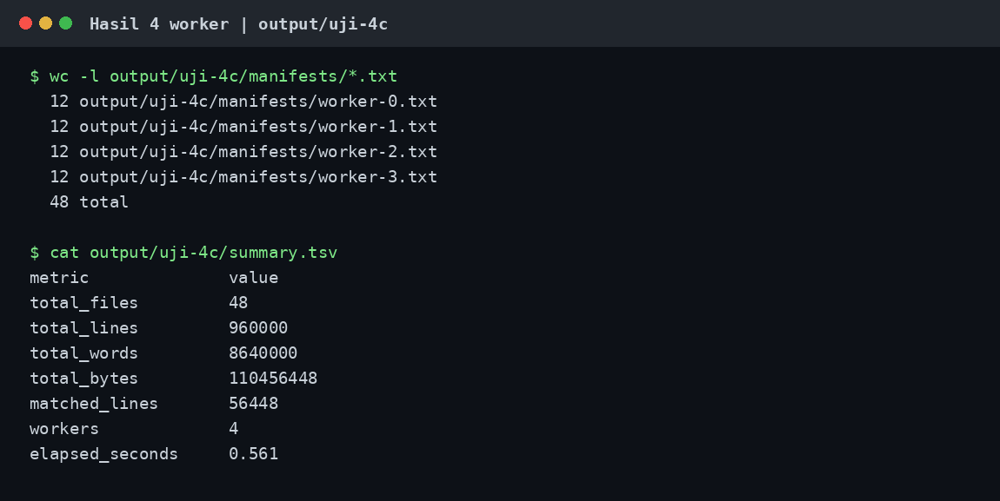
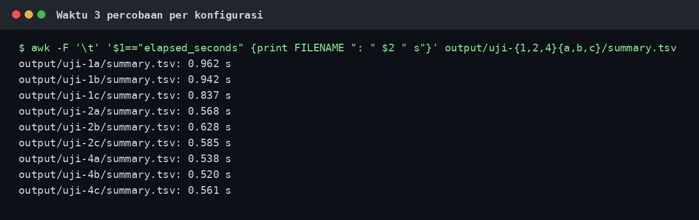

# Tugas Program Paralel dengan Shell

Nama: **Dzikri Bassyril Mu'minin**

NPM: **140810230071**

**Link project:** https://github.com/dzikribassyril/tugas-program-paralel-shell

Di sini saya mencoba membagi analisis 48 file log ke 1, 2, dan 4 worker. Yang dihitung: baris, kata, byte, dan berapa baris yang mengandung `ERROR`. Saya simpan perintah serta output yang keluar saat pengujian, jadi angka di bawah bisa dicek ulang lewat file di folder `output/`.

## 1. Menyiapkan program dan data

Saya pakai `parallel_analyzer.sh` untuk membagi pekerjaan, `worker.sh` untuk menghitung isi file, dan `generate_sample_data.sh` untuk membuat data contoh. Ini perintah saat saya membuat datanya:

```console
$ ./generate_sample_data.sh 48 20000 input
Data dibuat: 48 file x 20000 baris di input
$ du -sh input
106M    input
$ awk 'NR<=3 { print }' input/log-001.txt
2026-10-07 09:10:01 INFO file=001 event=000001 service=backend message=processing_request client=web status=active
2026-10-07 09:10:01 INFO file=001 event=000002 service=backend message=processing_request client=web status=active
2026-10-07 09:10:01 INFO file=001 event=000003 service=backend message=processing_request client=web status=active
```

Folder `input/` ada di komputer pengujian, tetapi tidak ikut diunggah ke GitHub karena berisi 106 MB data buatan. Kalau baru clone repo, jalankan `./generate_sample_data.sh 48 20000 input` untuk membuat data yang sama. Kalau `input/` sudah ada, tidak perlu mengulang; generator tidak akan menimpa folder lama.

## 2. Mengatur jumlah worker

Satu baris pada hostfile berarti satu worker. Saya siapkan versi 1, 2, dan 4 worker:

```console
$ wc -l hostfile-1 hostfile-2 hostfile
 1 hostfile-1
 2 hostfile-2
 4 hostfile
 7 total
$ cat hostfile
localhost
localhost
localhost
localhost
```

Karena saya mengetes di satu komputer, semua isinya `localhost`. Script menjalankan proses lokal di background (`&`), lalu menunggu semua selesai dengan `wait`. Kode juga mendukung SSH untuk host lain, tetapi bagian itu belum saya uji karena tidak ada komputer kedua dengan folder bersama.

## 3. Menjalankan 1 worker (serial)

```console
$ ./parallel_analyzer.sh input hostfile-1 ERROR output/uji-1c
File input: 48 | Worker: 1 | Kata kunci: ERROR
Worker 0 (localhost): selesai
Hasil: /home/dzikri/projects/HPC/Tugas-2/output/uji-1c/summary.tsv
Waktu eksekusi: 0.837 detik
```

## 4. Menjalankan 2 worker

```console
$ ./parallel_analyzer.sh input hostfile-2 ERROR output/uji-2c
File input: 48 | Worker: 2 | Kata kunci: ERROR
Worker 0 (localhost): selesai
Worker 1 (localhost): selesai
Hasil: /home/dzikri/projects/HPC/Tugas-2/output/uji-2c/summary.tsv
Waktu eksekusi: 0.585 detik
```

## 5. Menjalankan 4 worker

```console
$ ./parallel_analyzer.sh input hostfile ERROR output/uji-4c
File input: 48 | Worker: 4 | Kata kunci: ERROR
Worker 0 (localhost): selesai
Worker 1 (localhost): selesai
Worker 2 (localhost): selesai
Worker 3 (localhost): selesai
Hasil: /home/dzikri/projects/HPC/Tugas-2/output/uji-4c/summary.tsv
Waktu eksekusi: 0.561 detik
$ ls -1 output/uji-4c
details.tsv
manifests
summary.tsv
worker-0.tsv
worker-1.tsv
worker-2.tsv
worker-3.tsv
```

Dengan 4 worker, tiap worker kebagian 12 file. Saya cek dari daftar tugas (`manifest`) dan file hasil worker:

```console
$ wc -l output/uji-4c/manifests/*.txt
  12 output/uji-4c/manifests/worker-0.txt
  12 output/uji-4c/manifests/worker-1.txt
  12 output/uji-4c/manifests/worker-2.txt
  12 output/uji-4c/manifests/worker-3.txt
  48 total
$ awk 'NR<=4 { print }' output/uji-4c/worker-0.tsv
worker_id	file	lines	words	bytes	matched_lines
0	log-001.txt	20000	180000	2301176	1176
0	log-005.txt	20000	180000	2301176	1176
0	log-009.txt	20000	180000	2301176	1176
```

Isi `summary.tsv`:

```console
$ cat output/uji-4c/summary.tsv
metric	value
total_files	48
total_lines	960000
total_words	8640000
total_bytes	110456448
matched_lines	56448
workers	4
elapsed_seconds	0.561
```

`matched_lines` berarti jumlah baris yang memuat `ERROR`. Gambar berikut menampilkan pembagian 12 file per worker dan isi ringkasan di atas:



Gambar ini dirender dari output perintah pengujian yang tersimpan, bukan foto layar desktop.

## 6. Memastikan hasil benar

Saya tidak hanya percaya pada output script. Saya hitung lagi dengan `wc` dan `grep`:

```console
$ wc -l -w -c input/*.txt | awk 'END { print }'
   960000   8640000 110456448 total
$ grep -cF ERROR input/*.txt | awk -F: '{n += $NF} END {print "Baris berisi ERROR:", n}'
Baris berisi ERROR: 56448
```

Angkanya cocok dengan `summary.tsv`. Saya juga bandingkan hasil tiap file antara 1 dan 4 worker (kolom ID worker dibuang karena memang berbeda):

```console
$ diff -u <(cut -f 2- output/uji-1c/details.tsv | LC_ALL=C sort) <(cut -f 2- output/uji-4c/details.tsv | LC_ALL=C sort)
```

`diff` tidak menampilkan apa-apa dan selesai dengan exit status 0: semua hasil per file sama.

Saya coba juga dua input yang salah untuk melihat pesan error:

```console
$ ./parallel_analyzer.sh input hostfile ERROR output/uji-4c
Error: Direktori output sudah ada; pilih nama baru: /home/dzikri/projects/HPC/Tugas-2/output/uji-4c
$ ./parallel_analyzer.sh input hostfile-hilang ERROR output/gagal
Error: Bukan file host: /home/dzikri/projects/HPC/Tugas-2/hostfile-hilang
```

## 7. Hasil pengujian waktu

Supaya tidak bergantung pada satu kali pengukuran, saya jalankan masing-masing konfigurasi 3 kali secara berurutan (`a`, `b`, `c`). Setiap percobaan menyimpan output di folder baru seperti `output/uji-2a`.

Selain contoh percobaan `c` di atas, inilah perintah untuk `a` dan `b`:

```bash
./parallel_analyzer.sh input hostfile-1 ERROR output/uji-1a
./parallel_analyzer.sh input hostfile-2 ERROR output/uji-2a
./parallel_analyzer.sh input hostfile ERROR output/uji-4a
./parallel_analyzer.sh input hostfile-1 ERROR output/uji-1b
./parallel_analyzer.sh input hostfile-2 ERROR output/uji-2b
./parallel_analyzer.sh input hostfile ERROR output/uji-4b
```

| Worker | Percobaan a | Percobaan b | Percobaan c | Rata-rata | Speedup vs 1 worker |
|---:|---:|---:|---:|---:|---:|
| 1 | 0.962 s | 0.942 s | 0.837 s | 0.914 s | 1.00× |
| 2 | 0.568 s | 0.628 s | 0.585 s | 0.594 s | 1.54× |
| 4 | 0.538 s | 0.520 s | 0.561 s | 0.540 s | 1.69× |

Perintah untuk mengambil ulang angka dari hasil yang disimpan:

```console
$ awk -F '\t' '$1=="elapsed_seconds" {split(FILENAME,p,"/"); w=substr(p[2],5,1); sum[w]+=$2; n[w]++} END {a=sum[1]/n[1]; for(w=1;w<=4;w*=2){t=sum[w]/n[w];printf "%d worker: rata-rata %.3f detik, speedup %.2f x, efisiensi %.1f%%\n",w,t,a/t,100*a/t/w}}' output/uji-{1,2,4}{a,b,c}/summary.tsv
1 worker: rata-rata 0.914 detik, speedup 1.00 x, efisiensi 100.0%
2 worker: rata-rata 0.594 detik, speedup 1.54 x, efisiensi 77.0%
4 worker: rata-rata 0.540 detik, speedup 1.69 x, efisiensi 42.3%
```

Ini gambar waktu dari sembilan file hasil pengujian yang tersimpan:



**Yang saya dapat:** 4 worker kira-kira 1,69 kali lebih cepat daripada 1 worker pada data ini. Hasil hitungannya tetap sama. Dari 2 ke 4 worker peningkatannya lebih kecil; membaca file dan menjalankan proses juga butuh waktu. Angka waktu mungkin berbeda kalau dijalankan di komputer lain.

## Kesimpulan

Script utama membagi daftar file ke `manifests/worker-N.txt`. Setiap worker mengolah bagiannya dan menulis ke `worker-N.tsv` sendiri, jadi tidak berebut satu file. Setelah semua selesai, script utama menggabungkan hasil. Pengujian 1, 2, dan 4 worker memberi total yang sama, dan pada komputer ini mode paralel lebih cepat.
